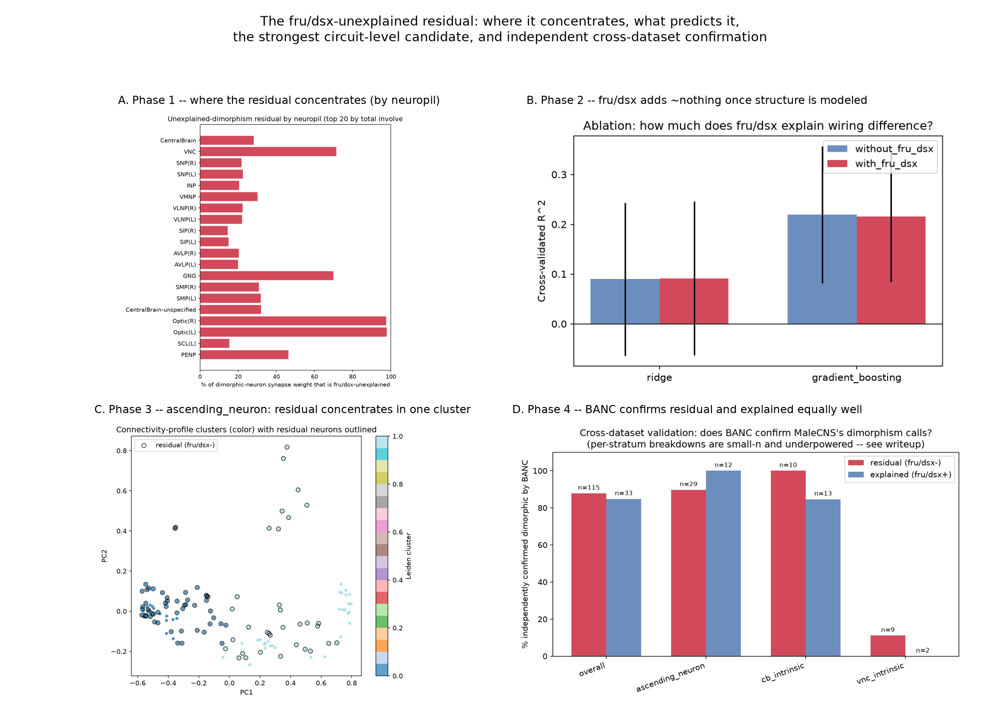

# FruResidual

Predicting sex-specific rewiring in the *Drosophila* connectome from the
*fruitless*/*doublesex* genetic switch — and treating the neurons the
switch can't explain as candidate evidence for a second, uncharacterized
driver of brain sex differences.

**Read the full result: [docs/paper.md](docs/paper.md)** (paper-shaped:
intro, methods, results, honest limitations, novelty statement). This
README covers setup and reproduction; the plan behind the project is in
[docs/project_plan.md](docs/project_plan.md).



## Headline result

Four independent lines of evidence, each gating the next:

1. **The residual is real and structured** (Phase 0/1) — 38.9-45.6% of
   dimorphic/male-specific neurons carry no *fru*/*dsx* annotation,
   concentrated sharply in the optic lobes (95-100%) and less sharply in
   the VNC/periphery (70-76%), against a well-explained central brain
   (14-32%).
2. **Structure predicts it about as well as the genetic switch does**
   (Phase 2) — a gradient-boosting model gets R²=0.507 from connectivity
   structure alone; adding *fru*/*dsx* as a feature moves that to
   R²=0.499, within noise. (A GNN on the connectome subgraph was tried
   and is reported as a negative result: too seed-unstable on this
   population to beat that baseline reliably.)
3. **One clean circuit-level candidate** (Phase 3) — `ascending_neuron`
   yields a non-confounded, resolution-robust connectivity cluster
   concentrating 60.7% of its residual neurons (odds ratio 2.68) plus 68
   significant partner-type motifs.
4. **Independently replicated** (Phase 4) — BANC, a second female
   reconstruction from a different research group, confirms the residual
   and the *fru*/*dsx*-explained set as dimorphic at statistically
   indistinguishable rates (86.8% vs. 82.1%, p=0.547) — the residual
   isn't disproportionately made of artifacts.

No new gene or confirmed mechanism is claimed. See
[docs/paper.md](docs/paper.md) section 6 for exactly what is and isn't
novel here, and section 5 for every limitation stated plainly.

## Project layout

```
configs/            config.yaml — paths, dataset ids, fru/dsx aggregation rule
data/                raw/ interim/ processed/ — gitignored, fetched via scripts/
docs/                paper.md (start here), project_plan.md, phaseN_results.md
notebooks/           scratch space only — the real entry points are scripts/
reports/figures/     small PNG deliverables per phase — tracked in git, unlike data/
scripts/             run_phaseN.py, download_*.py, make_summary_figure.py
src/fruresidual/     the actual package — data clients, features, models, eval, viz
tests/               pytest
```

## Environment setup (native Windows + conda/mamba)

Verified working end-to-end on 2026-09-16 (RTX 3050 Laptop GPU, driver
CUDA 13.3). Steps below are exactly what was run.

1. Install Miniforge (conda + mamba):
   ```
   winget install --id=CondaForge.Miniforge3 -e
   ```
2. Create the base environment (no PyTorch yet — see step 3):
   ```
   mamba env create -f environment.yml
   conda activate fruresidual
   ```
3. Install PyTorch via pip, **not conda** — conda-forge's `pytorch` +
   `pytorch-cuda=12.1` combo resolved to a CPU-only build here despite
   the CUDA pin. Pick the newest `whl/cuXXX` tag on
   [download.pytorch.org](https://download.pytorch.org/whl/torch/) that
   has a version matching (or close to) what `environment.yml` implies;
   `cu130` is what worked here:
   ```
   pip install torch --index-url https://download.pytorch.org/whl/cu130
   ```
   Verify it worked before moving on:
   ```
   python -c "import torch; print(torch.cuda.is_available(), torch.cuda.get_device_name(0))"
   ```
   This must print `True` and your GPU name. If it prints `False`, stop
   and fix this before continuing — everything downstream assumes GPU
   is visible.
4. Install PyTorch Geometric (must come after step 3, since it builds
   against the installed torch):
   ```
   pip install torch_geometric
   ```
5. Install the connectomics-specific clients — kept as separate installs
   so one flaky package can't break the rest; install one at a time:
   ```
   pip install navis
   pip install fafbseg   # pulls in caveclient as a dependency
   pip install banc
   ```
6. Copy `.env.example` to `.env` and fill in your neuPrint / CAVE tokens
   (see comments in that file for where to get them).
7. Sanity check everything at once:
   ```
   python -m pytest
   ruff check .
   ```
   Both must be clean. Note that `conda activate fruresidual` really is
   required first — calling the env's `python.exe` by absolute path
   without activating it leaves conda's `Library/bin` off `PATH`, and
   scikit-learn then dies with a Windows delay-load failure
   (`0xc06d007f`) deep inside its BLAS calls rather than a normal
   ImportError.

### Compute tiers

- **Local (this laptop, RTX 3050 4GB):** day-to-day dev — data pulls,
  joins, atlas building, baselines, GNN prototyping via mini-batch
  neighbor sampling.
- **Colab / Kaggle (free tier):** Linux-native fallback, zero install
  friction, bigger VRAM ceiling on demand.
- **College A5000 (24GB):** full GNN hyperparameter sweeps, the
  degree-preserving null-model reruns for significance testing, and
  Phase-4 cross-dataset validation runs.

## Data

Fetched separately from the repo, into `C:/FruResidualData` (see
"Environment setup" note above — kept off OneDrive so large downloads
aren't throttled). Get it with:
```
python scripts/download_male_cns.py   # MaleCNS bulk files, no auth needed
```
The FlyWire `flywire_annotations` table is fetched on first use by
`fruresidual.data.flywire_client.load_flywire_annotations` (also cached
into the same directory).

## Phase-by-phase reproduction log

The narrative result lives in [docs/paper.md](docs/paper.md); this
section is the per-phase build log — how to reproduce each phase
individually, and what was found while building it (including bugs
caught and fixed, not just clean headlines).

**Phase 0 (kill-gate): ALIVE.** Run `python scripts/run_phase0.py` to
reproduce. Full writeup: [docs/phase0_results.md](docs/phase0_results.md).
Headline: 38.9-45.6% of dimorphic/male-specific MaleCNS neurons have no
fru/dsx annotation (robust across both aggregation rules), and that
residual is statistically enriched (Fisher's exact, BH-corrected) in
optic-lobe-intrinsic neurons — essentially all of which lack a fru/dsx
call — plus smaller enrichment in ascending/descending VNC-connector
neurons. Non-trivial and structured, so the project proceeds to Phase 1.

**Phase 1 (atlas): done.** Run `python scripts/run_phase1.py` to
reproduce (needs `NEUPRINT_TOKEN` for a targeted, fast ROI query — not a
full-connectome pull). Full writeup:
[docs/phase1_results.md](docs/phase1_results.md). Figures:
[reports/figures/phase1/](reports/figures/phase1/). Headline: the
residual isn't just "optic lobe" — it's a peripheral-sensorimotor
pattern. Optic-lobe neuropils (ME, LO) are 95-100% fru/dsx-unexplained;
VNC/gnathal-ganglion/abdominal-tract regions sit at 70-76%; central-brain
integrative neuropils (SIP, AVLP, SNP) sit at 14-32%, closely explained.
Same pattern confirmed independently via superclass and soma-neuromere
enrichment. Doesn't yet distinguish real biology from an fru/dsx
annotation-coverage bias toward the central brain (the plan already
flags ~75% of annotation effort landed there) — that's Phase 3's job.

**Phase 2 (predictive model): done.** Run `python scripts/run_phase2_data.py`
then `python scripts/run_phase2.py` to reproduce (needs both
`NEUPRINT_TOKEN` and `CAVE_TOKEN`; the data step takes ~40 min — it
queries live FlyWire connectivity for 371 matched cell types).
Full writeup: [docs/phase2_results.md](docs/phase2_results.md). Figures:
[reports/figures/phase2/](reports/figures/phase2/). Headline: on a
634-case/634-control population (dimorphic vs. isomorphic, matched to
FlyWire types), a gradient-boosting baseline predicts wiring difference
reasonably well (R²=0.51) from structure alone — and adding fru/dsx as a
feature adds nothing (R²=0.50, within noise). The GNN on the real
connectome subgraph is reported as a **negative** result: swept over 10
seeds it gives R²=0.399 ± 0.478 (range -0.762 to +0.882) and beats the
gradient-boosting baseline on only 6/10 seeds, so it does not reliably
beat it — too little data (1,268 nodes) to train stably. An earlier
version of this claimed R²=0.735; that came from an unseeded run and a
single-split-vs-cross-validated comparison, both since fixed and
regression-tested. Per-neuron residual scores are saved for Phase 3,
plus an unplanned lead: several isomorphic-labeled neurons show
surprisingly high actual wiring difference, worth a look alongside
Phase 3's main analysis.

**Phase 3 (hypothesis): done.** Run `python scripts/run_phase3_data.py`
then `python scripts/run_phase3.py` to reproduce (~1 min total; the
first script fetches and caches the connectivity profiles, skipping
anything already cached). Full writeup:
[docs/phase3_results.md](docs/phase3_results.md). Figures:
[reports/figures/phase3/](reports/figures/phase3/). This phase found and
fixed three real bugs before trusting any result: a regional confound
(`ol_intrinsic` was 100% residual — zero internal variance, making any
comparison against it tautological) fixed by stratifying to superclasses
with a genuine residual/explained mix; a multi-label statistical bug
(partner-type membership isn't single-label like superclass — the first
implementation silently counted edges instead of neurons, corrupting
every p-value); and an unvalidated clustering resolution (a fixed,
never-checked value had silently replaced the sensitivity sweep the code
itself called for — fixed by actually sweeping 5 resolutions per stratum
and only trusting a cluster result robust across a majority of them). A
fourth issue — residual neurons being more highly connected overall in 2
of 3 strata — was found and reported, not corrected. Headline: the
cleanest, most validated result is in `ascending_neuron` (68 significant
partner-type motifs; a connectivity cluster holding 60.7% of residual
vs. 33% background, odds ratio 2.68, confirmed robust across the
resolution sweep, not an artifact of one parameter choice) — a genuine
candidate second-driver signature. The larger `cb_intrinsic` result
(1,397 significant motifs) is degree-confounded and shows no cluster
structure at any swept resolution — reported with that explicit caveat,
not presented as clean. Consolidated ranked shortlist (1,802 candidates,
read in tiers — see the writeup) saved to
`data_processed/phase3_candidate_shortlist.csv`.

**Phase 4 (cross-dataset validation): done.** Run
`python scripts/run_phase4.py` (needs `banc_888_meta.feather`, fetched
automatically on first run — 57.5MB, no auth). Full writeup:
[docs/phase4_results.md](docs/phase4_results.md). Figure:
[reports/figures/phase4/concordance_bar.png](reports/figures/phase4/).
The plan called for re-deriving Phase 2's wiring-difference metric using
BANC connectivity — not possible: our CAVE token authenticates fine but
this account lacks the separate, non-self-serve "view" permission BANC's
API requires. Adapted instead around what BANC's public bulk metadata
*does* expose with no auth: direct neuron-level MaleCNS cross-matches
plus BANC's own independent dimorphism calls. Matched 13,942 neurons
unambiguously. Headline: BANC confirms 85.8% of MaleCNS's dimorphism
calls (recall; precision is lower at 17.1% because BANC's own survey
flags more candidates overall — a real cross-group sensitivity
difference, not disagreement). The actual finding: residual (fru/dsx-
unexplained) and explained neurons are confirmed at statistically
indistinguishable rates (86.8% vs 82.1%, p=0.547) — the residual isn't
disproportionately made of artifacts, supporting that it reflects real,
independently-replicable biology.

All four data-driven phases (0-4) are now complete.

**Phase 5 (package): done.** Run `python scripts/make_summary_figure.py`
after Phases 1-4 to regenerate the headline figure at the top of this
README. This phase produced [docs/paper.md](docs/paper.md) (the
paper-shaped writeup), the headline figure, this README restructure, and
a repo-wide audit (dead config values, dead docs, lint, a
data-assumption check against the real files) — see the git history for
the audit commit if you want the details of what was checked.

